<div align="center">


<br/>


<br/><br/>

[](https://pypi.org/project/mcp-forge/)
[](https://www.python.org)
[](https://github.com/benni-os/mcp-forge/actions)
[](LICENSE)
[](https://mypy.readthedocs.io)
[](https://github.com/benni-os)
[](https://smithery.ai)
[](https://www.linkedin.com/in/benni-alencar/)

<br/>

> **"The FastAPI moment for MCP servers."**


<br/>



<br/>

</div>

<br/>

## ⭐ What Is mcp-forge?

**mcp-forge** eliminates MCP server boilerplate entirely. You write a typed Python function. The framework derives the JSON Schema from your type hints, validates inputs at runtime, and exposes the tool over STDIO, HTTP, or SSE — without changing a single line of your logic.

Every MCP server starts the same way: hand-craft JSON Schema, wire a transport loop, handle `notifications/initialized`, redirect stderr, copy-paste validation logic. **mcp-forge does all of that for you.**

```python
from mcp_forge import Forge

app = Forge(name="my-server", version="1.0.0")


@app.tool(description="Search the knowledge base")
async def search(query: str, limit: int = 10) -> list[dict]:
    """Returns ranked results for the given query."""
    ...  # your logic here


if __name__ == "__main__":
    app.run()  # STDIO — Claude Desktop / Cursor / VS Code ready
```

No JSON Schema by hand. No transport boilerplate. No config files.

<br/>


## ⚡ Core Doctrine

> These are not features. These are design laws.

| ☔ Principle | 🔧 Implementation |
|---|---|
| **Schema is Derived, Never Written** | Pydantic v2 generates full draft-07 JSON Schema from type hints — automatically |
| **Transport is a Runtime Concern** | STDIO · HTTP · SSE — switch with one flag, tool code never changes |
| **Contrib is Opt-In** | `app.include(memory)` adds tools; you stay in control, zero forced dependencies |
| **Strict by Default** | mypy strict + ruff + 100% typed public API — no surprises in production |
| **Testing Without a Server** | `ForgeTestClient` calls tools directly — no sockets, no mocking, no overhead |
| **Zero Boilerplate** | `@app.tool()` is the entire registration API — one decorator, full MCP compliance |

<br/>


## 🚀 Quick Start

```bash
# Install
pip install mcp-forge

# Scaffold + run
mcp-forge new my-server && cd my-server
mcp-forge run --reload
```

Connect to **Claude Desktop** in 30 seconds:

```json
{
  "mcpServers": {
    "my-server": {
      "command": "python",
      "args": ["-m", "my_server"]
    }
  }
}
```

Switch to **HTTP** transport with one flag:

```bash
mcp-forge run --transport http --port 8080
```

<br/>


## ✨ Features

| Feature | Description |
|---|---|
| 🏗️ **Declarative Tools** | `@app.tool()` — no schema files, no registration calls |
| 🧠 **Auto JSON Schema** | Pydantic v2 under the hood — full draft-07 generated from type hints |
| ✅ **Runtime Validation** | Inputs validated before execution — errors as proper MCP-spec responses |
| 🚀 **Multi-Transport** | STDIO · HTTP · SSE — switch at runtime, logic unchanged |
| ⏳ **Async-First** | `async def` and `def` tools work side by side — no event loop management |
| 🔌 **Contrib Routers** | `memory` · `filesystem` · `web` — one-line include |
| 🧪 **Testing Client** | `ForgeTestClient` — no server, no mocking, no sockets |
| 📦 **PEP 561 Typed** | Ships `py.typed` — full mypy strict + Pyright support |

<br/>


## 📚 Examples

### Minimal server

```python
from mcp_forge import Forge

app = Forge(name="calculator")


@app.tool()
def add(a: float, b: float) -> float:
    """Add two numbers."""
    return a + b


app.run()
```

### With contrib tools

```python
from mcp_forge import Forge
from mcp_forge.contrib import memory, filesystem, web

app = Forge(name="agent-tools")
app.include(memory)  # remember(), recall(), forget(), list_memory()
app.include(filesystem)  # read_file(), write_file(), list_dir(), delete_file()
app.include(web)  # fetch_url()

app.run()
```

### Unit testing — no server needed

```python
from mcp_forge.testing import ForgeTestClient

client = ForgeTestClient(app)


def test_add():
    result = client.call("add", {"a": 2, "b": 3})
    assert result == 5
```

<br/>


## 📁 Architecture

```
mcp-forge/
├── core/
│   ├── forge.py        ← Forge class — declarative app entrypoint
│   ├── schema.py       ← Auto JSON Schema from Pydantic v2
│   ├── validator.py    ← Input/output validation engine
│   ├── config.py       ← ForgeConfig dataclass
│   └── exceptions.py   ← MCP-aligned exception hierarchy
├── transports/
│   ├── stdio.py        ← STDIO — MCP spec 2024-11-05 compliant
│   ├── http.py         ← HTTP — FastAPI-based REST transport
│   └── sse.py          ← SSE — Server-Sent Events streaming
├── cli/
│   └── main.py         ← Typer CLI — new, run, validate, build
└── contrib/
    ├── memory.py       ← Scoped in-process memory store
    ├── filesystem.py   ← Safe filesystem tools with path sandboxing
    └── web.py          ← HTTP fetch with timeout and error handling
```

<br/>


## 📦 Installation

```bash
# Core only (STDIO transport)
pip install mcp-forge

# With HTTP + SSE transports
pip install "mcp-forge[http]"

# Everything
pip install "mcp-forge[all]"
```

**Requires:** Python 3.11+ · pydantic>=2.0

<br/>


## 🌍 Ecosystem Compatibility

| Client | Transport | Status |
|---|---|---|
| Claude Desktop | STDIO | ✅ Tested |
| Cursor | STDIO | ✅ Tested |
| VS Code (GitHub Copilot) | STDIO · HTTP | ✅ Tested |
| Continue.dev | HTTP · SSE | ✅ Tested |
| Custom LLM agents | HTTP · SSE | ✅ Tested |

<br/>


## 🤝 Contributing

Contributions are welcome. See [CONTRIBUTING.md](CONTRIBUTING.md) for the full guide.

```bash
git clone https://github.com/benni-os/mcp-forge
cd mcp-forge
pip install -e ".[dev]"
pytest
```

- 🐛 **Found a bug?** → [Open an issue](https://github.com/benni-os/mcp-forge/issues/new?template=bug_report.md)
- 💡 **Have an idea?** → [Start a discussion](https://github.com/benni-os/mcp-forge/discussions)
- 📜 **See what's planned** → [ROADMAP.md](ROADMAP.md)

<br/>


## 🌐 The Benni OS Ecosystem

`mcp-forge` is part of the **Benni OS** decentralized agentic architecture. The ecosystem is organized into modular **Public Open-Source Infrastructure** and **Proprietary Core Autonomous Systems**:

### 🔓 Public Open-Source Infrastructure

| Layer / Domain | Repository | Maintainer | Description | Status |
|---|---|---|---|---|
| **Security & Defense** | [**`agent-cyber-sentinel`**](https://github.com/BenniAlencar/agent-cyber-sentinel) | `@BenniAlencar` | Tier-0 Zero-Trust runtime security shield, prompt injection firewall & secret redactor. | 🟢 Stable (Apache-2.0) |
| **Execution & State** | [**`agent-run-ledger`**](https://github.com/BenniAlencar/agent-run-ledger) | `@BenniAlencar` | Resumable multi-step execution state machine, anti-loop circuit breaker & crash recovery. | 🟢 Stable (Apache-2.0) |
| **Long-Term Memory** | [**`agent-memory-mesh`**](https://github.com/BenniAlencar/agent-memory-mesh) | `@BenniAlencar` | Sovereign bi-temporal knowledge graph & episodic memory with multi-tenant isolation. | 🟢 Stable (Apache-2.0) |
| **Zero-Trust Verification** | [**`reality-lock`**](https://github.com/BenniAlencar/reality-lock) | `@BenniAlencar` | Cryptographic execution verification & signed SHA-256 evidence ledgers for side-effects. | 🟢 Stable (Apache-2.0) |
| **Autonomous Web Perception** | [**`agent-browser-mesh`**](https://github.com/BenniAlencar/agent-browser-mesh) | `@BenniAlencar` | High-speed, zero-token-waste autonomous browser engine with semantic DOM-Delta compaction & native MCP. | 🟢 Stable (Apache-2.0) |
| **MCP Tooling Matrix** | [**`mcp-forge`**](https://github.com/benni-os/mcp-forge) | `Benni-OS` | Rapid developer toolchain for building, validating, and publishing Model Context Protocol servers. | 🟢 Public OSS |
| **Local Hybrid Inference** | [**`benni-inference-engine`**](https://github.com/benni-os/benni-inference-engine) | `Benni-OS` | GPU+CPU MoE expert offloading runtime with Skill 81 Ceiling Extraction on consumer hardware. | 🟢 Public OSS |
| **Federated Execution** | [**`benni-operator-gateway`**](https://github.com/benni-os/benni-operator-gateway) | `Benni-OS` | Unified policy-governed operator gateway for dispatching actions across local and cloud environments. | 🟢 Public OSS |
| **Model Routing Hub** | [**`benni-nexus`**](https://github.com/benni-os/benni-nexus) | `Benni-OS` | Intelligent LLM model router optimizing for latency, cost, and task-specific reasoning ceilings. | 🟢 Public OSS |
| **Autonomous Community** | [**`community-autopilot`**](https://github.com/benni-os/community-autopilot) | `Benni-OS` | Autonomous event-driven community management, issue triage, and repository telemetry. | 🟢 Public OSS |

---

### 🔒 Proprietary Core & Autonomous Systems (Enterprise Benni OS)

The open-source stack serves as the decentralized foundation for the enterprise-grade Benni OS autonomous swarm kernel:

| System | Role & Scope | Architecture Doctrine | Access |
|---|---|---|---|
| **Benni Master OS** | Central operating system kernel v9.4 governing 43 canonical skills, runtime contracts, and swarm coordination. | `Universal Skills 00–100` | 🔒 Private Core |
| **Project Benjamin** | Sovereign autonomous execution orchestrator with typed handoff contracts and zero-human-in-the-loop loops. | `Skill 93 Autonomous Dispatch` | 🔒 Private Core |
| **Project Adam** | Agent synthesis, benchmark evaluation, and continuous recursive self-evolution engine. | `Skill 92 Self-Evolution` | 🔒 Private Core |
| **Benni Control Plane** | Distributed state persistence, atomic snapshot restore protocols, and multi-tenant ledger governance. | `Skill 90 Control Plane OS` | 🔒 Enterprise |
| **Benni Social Hub** | Multi-channel content authority distribution, attribution engine, and automated revenue funnels. | `Skill 52 & Skill 95 Revenue Loop` | 🔒 Enterprise |
| **Benni Canvas** | Autonomous UI engineering subsystem v14.0 delivering generative high-end motion and responsive dashboards. | `Skill 54 Open Design & Skill 56` | 🔒 Enterprise |
| **Benni Nemesis** | Federated integration gateway connecting cloud APIs, vector databases, and multi-cloud webhooks. | `Skill 97 Nemesis Gateway` | 🔒 Private Core |
| **Benni OS Genesis** | Structured prompt engineering compilation and generative knowledge distillation engine. | `Skill 70 Model Behavior` | 🔒 Private Core |

---

👉 **Explore & Connect with the Benni OS Ecosystem:**
* **Official Website**: [https://benni-os.net](https://benni-os.net)
* **Maintainer Profile**: [https://github.com/BenniAlencar](https://github.com/BenniAlencar)
* **LinkedIn**: [https://www.linkedin.com/in/benni-alencar/](https://www.linkedin.com/in/benni-alencar/)
* **GitHub Organization**: [https://github.com/benni-os](https://github.com/benni-os)
* **Documentation & Architecture**: [https://benni-os.net](https://benni-os.net)

<br/>


<div align="center">

**mcp-forge** — *Open-Source Python MCP Framework by [Benni OS](https://github.com/benni-os)*

`ZERO_BOILERPLATE` • `AUTO_SCHEMA` • `MULTI_TRANSPORT` • `STRICT_TYPING` • `MIT_LICENSE`

Engineered by **Benni Alencar** and the Benni OS Core Engineering Group · *If mcp-forge saves you time, give it a ⭐*

</div>


* **[`agent-deep-research`](https://github.com/BenniAlencar/agent-deep-research)**: Autonomous multi-source deep research engine with cryptographic citation proofs & >85% token distillation.


* **[`agent-code-sandbox`](https://github.com/BenniAlencar/agent-code-sandbox)**: Micro-second zero-dependency code sandbox with AST security guards & context token shielding.
* **[`agent-eval-harness`](https://github.com/BenniAlencar/agent-eval-harness)**: Deterministic zero-cloud agent evaluation & red-teaming harness with cryptographic audit receipts.
